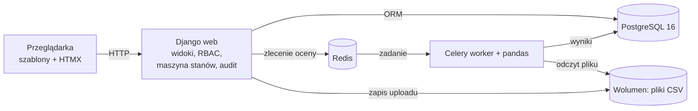
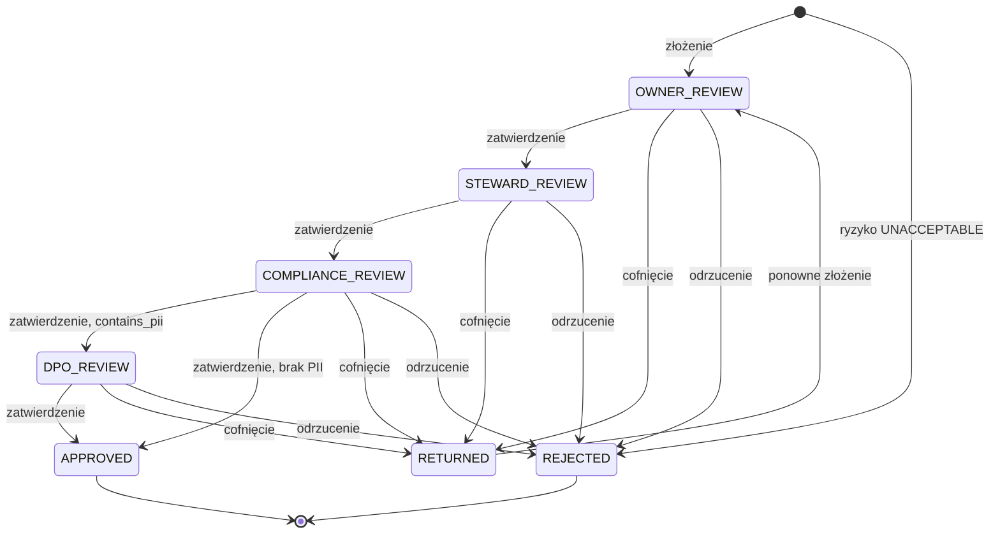
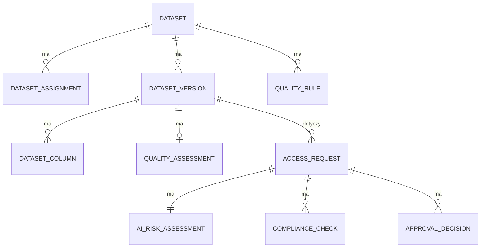

# plan.md: JAK budujemy

**Status:** Propozycja v0.1 · **Powiązane:** `spec.md`, `tasks.md`, `docs/adr/`

## 1. Stos (propozycja, patrz ADR-0001…0010)
| Warstwa | Technologia |
|---|---|
| Prezentacja | Szablony Django, HTMX, Bootstrap 5, Chart.js, Mermaid (S6) |
| Aplikacja | Python 3.12, Django 5.2 LTS |
| Przetwarzanie w tle | Celery + Redis, pandas |
| Dane | PostgreSQL 16 (relacje + JSONB), pliki w wolumenie Dockera |
| S6 | Presidio (NER), WeasyPrint (PDF), MinIO (opcjonalnie) |
| Uruchomienie | Docker Compose: web, worker, postgres, redis |

## 2. Architektura (kontenery)


## 3. Maszyna stanów wniosku

Każda decyzja wymaga uzasadnienia. Etap Ownera i Stewarda zatwierdza jedna z osób przypisanych do zbioru. Wniosek z PII nie osiąga APPROVED bez DPO (test własności).

## 4. Model danych (MVP)

| Tabela | Kluczowe pola |
|---|---|
| datasets | id (UUID), name, description, tags, status (DRAFT/ACTIVE/ARCHIVED), refresh_sla_days |
| dataset_assignments | dataset_id, user_id, role (OWNER/STEWARD); unikalna trójka dataset+user+role |
| dataset_versions | dataset_id, version_no, file_path, row_count, contains_pii, processing_status, uploaded_by |
| dataset_columns | version_id, name, dtype, classification, detected_type, classified_by (AUTO/MANUAL) |
| quality_rules | dataset_id, dimension, kind (RANGE/REGEX/ALLOWED_VALUES/CROSS_COLUMN), columns, params (JSONB) |
| quality_assessments | version_id, 5 wymiarów (NULL = nieoceniony), dqs, column_details (JSONB) |
| access_requests | dataset_version_id, requester_id, ai_project_name, purpose, valid_until, state |
| ai_risk_assessments | request_id (1:1), questionnaire_version, answers (JSONB), risk_level |
| compliance_checks | request_id, kind (GDPR/ART10), results (JSONB), checked_by |
| approval_decisions | request_id, stage, reviewer_id, decision (APPROVE/REJECT/RETURN), justification, decided_at |
| audit_log | actor_id, ip, ts_utc, action, object_type, object_id, before, after (INSERT-only) |
| S6 | lineage_nodes, lineage_edges |

## 5. Struktura repozytorium (docelowa)
```
ai-data-governance-platform/
├── docker-compose.yml
├── .env.example
├── manage.py
├── config/            # settings, urls, konfiguracja Celery
├── apps/
│   ├── accounts/      # użytkownicy, role, tryb demo
│   ├── catalog/       # zbiory, wersje, kolumny, klasyfikacja PII, lineage
│   ├── quality/       # reguły, silnik 5 wymiarów, DQS, dashboard
│   ├── compliance/    # kwestionariusz AI Act, checklisty RODO i art. 10
│   ├── workflow/      # wnioski, maszyna stanów, decyzje
│   └── audit/         # audit log
├── templates/
├── static/
├── seed/              # generator 3 zbiorów demo (Faker pl_PL)
└── docs/
```

## 6. Dane demo
Trzy zbiory syntetyczne: wnioski kredytowe (PII, braki, nierówny wiek; ryzyko wysokie), telemetria IoT (bez PII, wysoka jakość), rekrutacja IT (dane wrażliwe, duplikaty; ryzyko wysokie). PESEL-e syntetyczne z poprawną sumą kontrolną.

## 7. Zależności od decyzji zespołu
Stos, zakres semestru V, wersja DPIA: patrz `tasks.md` i arkusz decyzji.